<!-- ===================== HEADER ===================== -->

  

  

  

  
  
  
  
  

  

<!-- ===================== ABOUT ===================== -->
##  `whoami`

- 👋 Hi, I'm **Hwarin**, an Informatics student from **Indonesia** 🇮🇩 focused on **machine learning**
- 👁️ I build **computer vision** systems: face verification, liveness & anti-spoofing, object detection and counting
- 🧪 I take models the whole way: **dataset → annotation → training → evaluation → deployment**
- 🔌 I like putting models on **real devices** (cameras, ESP32, servos), not just in notebooks
- ✍️ Outside of code, I write **fantasy fiction**

<table>
  <tr>
    <td valign="top" width="50%">
      <b>🔨 Building</b> 
      • Face verification with layered liveness checks 
      • Dense object counting with YOLO 
      • ML-powered IoT devices
    </td>
    <td valign="top" width="50%">
      <b>🔭 Exploring</b> 
      • Edge deployment with ONNX Runtime 
      • Model evaluation &amp; robustness 
      • Voice conversion (RVC)
    </td>
  </tr>
</table>

  

  

<!-- ===================== TECH STACK ===================== -->
## 🛠️ `ml-stack`

  

<b>Machine Learning &amp; Computer Vision</b>

  

  
  
  
  
  
  

<b>Serving models &amp; devices</b>

  

<b>Web &amp; apps around the models</b>

  

  

<!-- ===================== PROJECTS ===================== -->
## 🚀 `ml-projects`

<table>
  <tr>
    <td width="50%" valign="top">
      <h3>🛡️ Absen: Face-Verified Attendance</h3>
      
Server-side face verification with layered liveness checks: capture quality, a randomised head-movement challenge, temporal consistency, passive anti-spoofing, then a 1:1 face match. Web dashboard and Flutter mobile app.

      

        
        
        
        
        
      

      <a href="https://github.com/Hwarinn66/Attendance-Face-Recognition"><b>→ Explore repository</b></a>
    </td>
    <td width="50%" valign="top">
      <h3>🔢 Dense Object Counter</h3>
      
Detects and counts densely packed objects with YOLO11 or OpenCV detectors, tiled inference for high-resolution images, ROI counting, and a dataset and training pipeline.

      

        
        
        
        
      

      <a href="https://github.com/Hwarinn66/Dense-Object-Counter"><b>→ Explore repository</b></a>
    </td>
  </tr>
  <tr>
    <td width="50%" valign="top">
      <h3>♻️ Smart Trash</h3>
      
Waste sorter: a MobileNetV2 transfer-learning model classifies organic vs. non-organic waste from a live camera, and an ESP32 turns a servo to the right bin, with Blynk monitoring.

      

        
        
        
      

      <a href="https://github.com/Hwarinn66/Smart-Trash"><b>→ Explore repository</b></a>
    </td>
    <td width="50%" valign="top">
      <h3>🧠 InnerSelf Cognitive</h3>
      
32 cognitive-function questions. A TF-IDF + logistic regression model classifies users' written reasons, and the explanation quotes their own answers.

      

        
        
        
      

      <a href="https://github.com/Hwarinn66/MBTI-Test-With-ML"><b>→ Explore repository</b></a>
    </td>
  </tr>
  <tr>
    <td width="50%" valign="top">
      <h3>👁️ Face Recognition v1 (research)</h3>
      
Journal research prototype: MobileNetV2 face recognition, blink-based liveness with MediaPipe Face Mesh, and a central server with three Socket.IO clients.

      

        
        
        
      

      <a href="https://github.com/Hwarinn66/face-recognition"><b>→ Explore repository</b></a>
    </td>
    <td width="50%" valign="top">
      <h3>✋ Gesture Hand</h3>
      
Real-time hand tracking that opens websites from finger gestures, built on MediaPipe Hands and OpenCV.

      

        
        
      

      <a href="https://github.com/Hwarinn66/Gesture-Hand"><b>→ Explore repository</b></a>
    </td>
  </tr>
</table>

  

  
<b>🧩 Other things I've built (web &amp; systems)</b>

   

| Project | What it is | Stack |
| --- | --- | --- |
| [Portfolio](https://github.com/Hwarinn66/portfolio) | Personal site with animated project diagrams | Next.js · GSAP |
| [Stock Recording (Laravel)](https://github.com/Hwarinn66/Stock-Recording-Laravel) | QR warehouse stock: scan → pending → approve | Laravel 12 · MariaDB |
| [Stock Recording (TypeScript)](https://github.com/Hwarinn66/Stock-Recording-TypeScript) | Same system with real-time SSE | Next.js · MySQL |
| [Payroll System](https://github.com/Hwarinn66/Payroll-System) | Employee payroll management | CodeIgniter 4 |
| [Laptop Recommendation](https://github.com/Hwarinn66/laptop-recomendation-with-binary-tree) | Recommender on a binary search tree | Flask |

  

  

<!-- ===================== TRAINING ===================== -->
## 🧪 `training-loop`

  

  

<!-- ===================== STATS ===================== -->
## 📊 `github-activity`

  
  

  

## 🐍 `contribution-snake`

  

  

<!-- ===================== CURRENTLY ===================== -->
## 🌱 `currently`

  

  

<!-- ===================== CONNECT ===================== -->
## 🤝 `connect`

  

  

